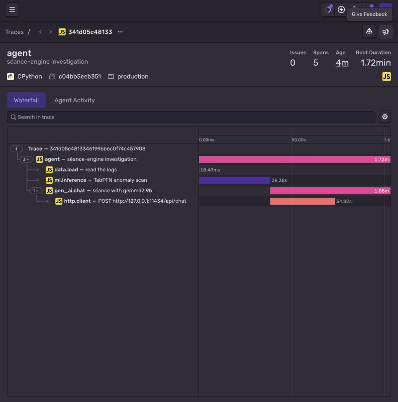

# 👻 The Séance Engine

Finds the ghost in your system logs with **TabPFN**, then lets **Gemma** (local, via Ollama) tell its story. Traced end to end with **Sentry**.



## Run

```bash
ollama pull gemma2:9b
pip install -r requirements.txt
python seance_engine.py              # generates ghost_logs.csv with a 3:33 AM haunting
python seance_engine.py my_logs.csv  # or your own CSV (hour, cpu_usage, memory_usage, network_io_mb, timestamp, active_app)
SENTRY_DSN="your-dsn" python seance_engine.py   # optional tracing
```

## How the ghost is found

For each row, TabPFN sees the other rows (labelled real) next to uniform noise (labelled noise) and scores how real the held-out row looks. The lowest score is the ghost. Normal hours score 0.66–0.99; the 3:33 AM spike scores 0.006.

`tabpfn==2.0.9` + `numpy<2` are pinned so it runs on Intel Macs (PyTorch 2.2).
